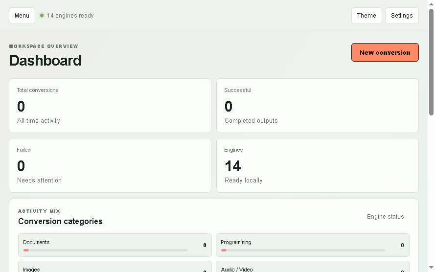
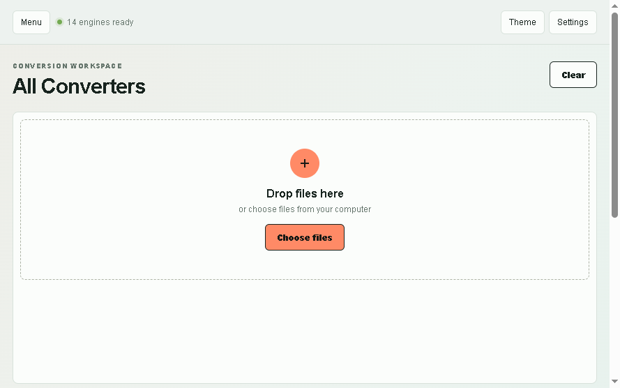

# UNIVERSAL CONVERTER

[](https://github.com/surjolive/universal-converter/actions/workflows/tests.yml)
[](https://github.com/surjolive/universal-converter/releases/latest)

Offline-first local file conversion application.

**Developed by SURJO LIVE**

## Screenshots

### Dashboard



### Conversion workspace



## Requirements

- Windows 10/11
- Python 3.12 or newer
- Optional FFmpeg for audio/video conversion
- Optional LibreOffice for office document conversion
- Optional WinRAR for creating and previewing RAR archives
- Optional PHP/Node.js runtimes for explicitly enabled code-processing features

## Install on Windows

Download `Universal-Converter-Setup.exe` from [GitHub Releases](https://github.com/surjolive/universal-converter/releases/latest) and run it. The per-user installer includes the Python runtime and app dependencies, displays installation progress, creates shortcuts, and can launch the app when setup finishes. Python is not required on the target computer.

The installer stores settings, uploads, conversion history, and hosted files under `%LOCALAPPDATA%\Universal Converter`. Optional tools such as FFmpeg and LibreOffice are not bundled; install them separately to enable their conversion routes.

## Run from Source

Requirements: Windows 10/11 and Python 3.12 or newer.

```powershell
git clone https://github.com/surjolive/universal-converter.git
cd universal-converter
.\Install.bat
.\Start.bat
```

The local web interface opens at `http://127.0.0.1:8765`. Use `Stop.bat` to stop the server. `Install.bat` creates `.venv`, installs the Python dependencies, and reports optional conversion tools found on the computer.

## Build the Windows Installer

After running `Install.bat`, run `Build-EXE.bat`. It builds the desktop app and packages it into `dist/Universal-Converter-Setup.exe`. Generated build output is intentionally excluded from Git; published installers are attached to GitHub Releases.

## API and Tests

Open `http://127.0.0.1:8765/api/docs` for interactive local API documentation.

## Test

```powershell
.\.venv\Scripts\python.exe -m pytest -q
```

## Security

The application binds to loopback by default. Uploaded PHP and Python source is never executed automatically. Runtime settings, local databases, uploads, generated conversions, and build outputs are excluded from the public repository.

## Support and Contributions

For help, email [surjolivemailbox@gmail.com](mailto:surjolivemailbox@gmail.com). See [CONTRIBUTING.md](CONTRIBUTING.md) before opening a pull request and [SECURITY.md](SECURITY.md) for private vulnerability reports.

## License

No license has been selected yet. Until a license is added, the source is public for viewing but reuse and redistribution are not granted.
